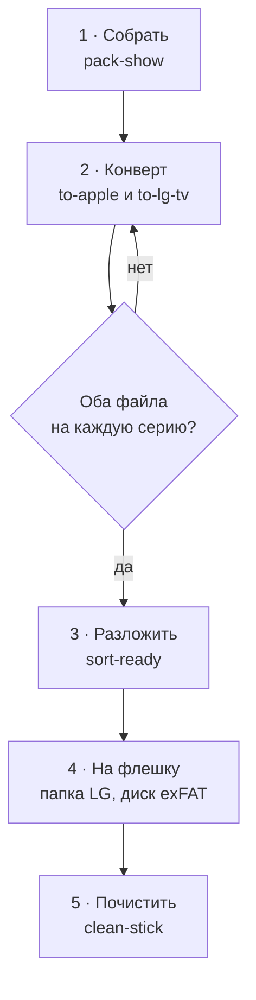

# Скрипты

Команды в Терминале. Сначала `cd` в папку с файлами. Результат появляется рядом.

## Подготовка

Один раз на каждом Mac.

`~/.zshrc` — записная книжка Терминала. Её надо один раз открыть и дописать строку, иначе команды скриптов не находятся.

```bash
open -e ~/.zshrc
# откроется записная книжка Терминала
# в конец файла вставить строку ниже. Старые строки не удалять
export PATH="$HOME/DEV/scripts/bin:$PATH"
# чтобы Терминал находил to-apple и остальные скрипты
# сохранить файл: Cmd+S
source ~/.zshrc
# прочитать записную книжку в этом окне
which to-apple
# должно вывести: …/DEV/scripts/bin/to-apple
```

Если программы для видео ещё нет, поставить её до запуска скриптов:

```bash
brew install ffmpeg
```

Для имени и обложки фильма нужна ещё одна программа. Если она уже стоит, вторая команда покажет номер.

```bash
brew install exiftool
# поставить программу, которая записывает имя и обложку в mp4
exiftool -ver
# должен появиться номер, например 13.55
```

## Скрипты

-   
  Сезоны лежат папками (`s01` или длинное имя вроде `Show.S01`). Собирает серии в одну папку: `S01E01 · Название`. Если названия серии нет — только `S01E01`.

-   
  Файл для Mac и iPhone. В конце имени будет `_apple.mp4`. Размер и качество уже выбраны: вы указываете файлы и дорожки.

-   
  Имя файла и название в приложении TV: `Пила 1 [Saw] 2004`. Постер сам скачивается с Кинопоиска. Видео заново не сжимается.

-   
  Файл для телевизора LG. В конце имени будет `_lgc2.mkv`. Звук делается таким, чтобы телек его играл, а не молчал.

-   
  Чинит буквы в субтитрах уже готового файла. Английскую строку из больших букв делает обычным предложением. Для Apple и для телека.

-   
  Когда для серии есть оба готовых файла, раскладывает их в папки `Apple/` и `LG/` и убирает пометку из имени. Исходник удаляет. Если готов только один файл, серию не трогает.

-   
  Запускать на флешке после копирования. Удаляет спрятанные файлы `._`, которые телек показывает как битые ролики, и проверяет, что они исчезли.

-   
  То же перекодирование, но ширину и качество выбираете сами. Один файл за раз.

-   
  Вырезает кусок из уже готового mp4. Заново видео не пережимает.

-   
  Из Word и DjVu делает txt и docx для Pages. Сноски в книге становятся номерами.

-   
  Не про видео. Собирает палитру цветов Tailwind в файл для Mac.

`to-apple` и `to-lg-tv` на время работы не дают Mac уснуть. Питание от сети, крышку ноутбука не закрывать. `Ctrl+C` останавливает очередь.

## Сериалы




**1 · Собрать.** В папке сериала лежат папки сезонов: `s01` или длинное имя вроде `Show.S01`.

```bash
pack-show
```

**2 · Конверт.** Зайти в новую папку. Номера файлов через пробел: `1 3 5`. Пока нет и `_apple`, и `_lgc2`, шаг 3 не делать.

```bash
to-apple
to-lg-tv
```

**3 · Разложить.** Готовая пара уходит в `Apple/` и `LG/`. Одна готовая дорожка из двух — серия остаётся на месте.

```bash
sort-ready
```

**4 · На флешку.** Копировать только `LG/` на exFAT.

**5 · Почистить.** Терминал уже на флешке, не на диске Mac.

```bash
clean-stick
```

В конце должно быть `Gone`.

## Фильм

Без `pack-show`. Дальше те же шаги 2–5.

Имя, год, жанр и обложка — пока файл ещё на Маке. Скрипт сам предлагает название и жанр, постер кладёт png в `Pictures/Video`.

```bash
tag-movie
# номера mp4
# строка с названием — Enter оставляет её
# жанр — Enter оставляет, цифра из списка меняет
# нет английского — Enter, имя без скобок. Убрать чужое: n, 0, минус
# имя станет таким: Пила 1 [Saw] 2004
# в конце должно быть Done
```

Потом в приложении TV добавь файл, которого там ещё не было, и посмотри, открылся ли он в «Фильмы».

Если фильм уже был в библиотеке, обложка не обновится сама. Убери его из библиотеки (файл на Маке не удаляй) и добавь mp4 снова.
