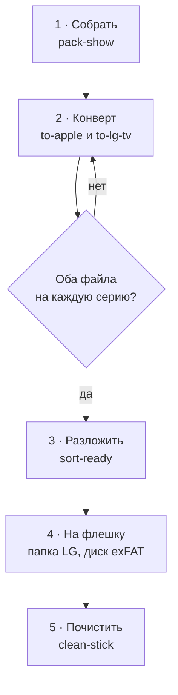

# Скрипты

Команды в Терминале. Сначала `cd` в папку с файлами. Результат появляется рядом.

## Подготовка

Один раз на каждом Mac.

`~/.zshrc` — записная книжка Терминала. Её надо один раз открыть и дописать строку, иначе команды скриптов не находятся.

```bash
open -e ~/.zshrc
# откроется записная книжка Терминала
# в конец файла вставить строку ниже. Старые строки не удалять
export PATH="$HOME/DEV/scripts/bin:$PATH"
# чтобы Терминал находил to-apple и остальные скрипты
# сохранить файл: Cmd+S
source ~/.zshrc
# прочитать записную книжку в этом окне
which to-apple
# должно вывести: …/DEV/scripts/bin/to-apple
```

Если программы для видео ещё нет, поставить её до запуска скриптов:

```bash
brew install ffmpeg
```

Для имени и обложки фильма нужна ещё одна программа. Если она уже стоит, вторая команда покажет номер.

```bash
brew install exiftool
# поставить программу, которая записывает имя и обложку в mp4
exiftool -ver
# должен появиться номер, например 13.55
```

## Скрипты

-   
  Сезоны лежат папками (`s01` или длинное имя вроде `Show.S01`). Собирает серии в одну папку: `S01E01 · Название`. Если названия серии нет — только `S01E01`.

-   
  Файл для Mac и iPhone. В конце имени будет `_apple.mp4`. Размер и качество уже выбраны: вы указываете файлы и дорожки.

-   
  Имя файла и название в приложении TV: `Пила 1 [Saw] 2004`. Постер сам скачивается с Кинопоиска. Видео заново не сжимается.

-   
  Для сериала. Запускать в папке `Apple`. Название сериала берёт из папки над ней, поэтому та папка должна называться как сериал. Сезон и серию берёт из имени файла. Одна обложка на все серии.

-   
  Файл для телевизора LG. В конце имени будет `_lgc2.mkv`. Звук делается таким, чтобы телек его играл, а не молчал.

-   
  Одна аудиокнига для приложения Книги. Главы из всех файлов папки, автор и чтец уже внутри.

-   
  Те же главы отдельными mp3 для телевизора LG и для Книг. Номер, автор и чтец уже внутри. Готовый mp3 не пережимается.

-   
  Обложка: портрет сверху, название большими буквами снизу. Шрифт Angelica.

-   
  Чинит буквы в субтитрах уже готового файла. Английскую строку из больших букв делает обычным предложением. Для Apple и для телека.

-   
  Английские субтитры с WatchEnglish: сезон сериала или один фильм. В текущую папку кладёт `S02E01 · Next.srt` или `The Dark Knight.srt`. Ролик не скачивает.

-   
  Приклеивает субтитры из отдельного файла к копии ролика. Исходный файл не меняется. Для сезона на 25 кадрах можно задать свой сдвиг.

-   
  Спрашивает, какой звук и какие субтитры включены, когда файл открывается. Для уже готовых роликов. Те же вопросы задают конвертация и приклейка субтитров.

-   
  Когда для серии есть оба готовых файла, раскладывает их в папки `Apple/` и `LG/` и убирает пометку из имени. Исходник удаляет. Если готов только один файл, серию не трогает.

-   
  Запускать на флешке после копирования. Удаляет спрятанные файлы `._`, которые телек показывает как битые ролики, и проверяет, что они исчезли.

-   
  То же перекодирование, но ширину и качество выбираете сами. Один файл за раз.

-   
  Вырезает кусок из уже готового mp4. Заново видео не пережимает.

-   
  Из Word и DjVu делает txt и docx для Pages. Сноски в книге становятся номерами.

-   
  Не про видео. Собирает палитру цветов Tailwind в файл для Mac.

-   
  Шрифты в корне папки. Каждый файл уходит в папку своего названия, хвост из цифр в имени убирается. В корне остаётся то, что ещё не разобрано.

`to-apple`, `to-lg-tv`, `to-m4b` и `to-mp3` на время работы не дают Mac уснуть. Питание от сети, крышку ноутбука не закрывать. `Ctrl+C` останавливает работу.

## Субтитры с WatchEnglish

Адрес страницы — из адресной строки браузера. Для сериала скрипт берёт серии, которые на сайте отмечены как готовые. Для фильма — один файл. Нужны не все серии — номера через пробел после адреса: `1 3`.

Сериал:

```bash
cd ~/Movies
# открыть папку, куда положить субтитры
get-subs "https://watchenglish.tv/shows/desperate-housewives?season=2"
# скачать английские субтитры готовых серий этого сезона
# ожидается: S02E01 · Next.srt и в конце Done
```

Фильм:

```bash
cd ~/Movies
# открыть папку, куда положить субтитры
get-subs "https://watchenglish.tv/movies/the-dark-knight"
# скачать английские субтитры этого фильма
# ожидается: The Dark Knight.srt и в конце Done
```

## Приклеить субтитры

Ролики лежат в папке, откуда запущена команда. Субтитры она ищет так:

| Что рядом с роликом | Какой файл берёт |
|---|---|
| Серия `S02E02.mkv` | сначала `subs/S02E02….srt`, затем `S02E02….srt` в папке с роликом |
| Фильм `Film.mkv` | сначала `subs/Film.srt`, затем `Film.srt` рядом с роликом |

Для второго сезона «Отчаянных домохозяек» подошёл сдвиг **0,6 секунды** позже. Enter в вопросе про сдвиг оставляет это число. Другое число: плюс — текст позже, минус — раньше. В режиме 2 строки сайта в субтитры не попадают.

Весь сезон, копии без пометки `.eng` в имени. Исходные ролики остаются на месте. Новые лежат в папке `ready` и называются так же, как исходник.

```bash
cd ~/Movies/show
# открыть папку с роликами. Файлы srt лежат в папке subs
add-subs
# s02 — весь второй сезон. Enter взял бы все ролики в этой папке
# режим 2 — подогнать 25 кадров и сдвиг. Enter оставляет 0.6
# язык новой дорожки: Enter оставляет English
# когда спросит папку, написать ready
# звук: Enter оставляет тот, что уже играет. 1 — английский, 2 — русский
# субтитры: Enter оставляет их выключенными. 1 включает английские при открытии
# ожидается: последняя строка Done. Рядом с роликами папка ready, внутри S02E02.mkv
```

Фильм, субтитры уже совпадают со звуком:

```bash
cd ~/Movies
# открыть папку, где лежат фильм и его srt с тем же именем
add-subs
# режим 1 — приклеить как есть. Enter на сдвиге оставляет 0
# язык новой дорожки: Enter оставляет English, 2 — русские
# папка: Enter оставляет копию рядом, в имени будет .eng
# звук и субтитры при открытии — те же вопросы, что у сезона
# ожидается: копия Film.eng.mkv, исходный файл на месте
```

## Какой звук и субтитры включены

Скрипт для уже готового файла. Картинку заново не сжимает. В плеере дорожку по-прежнему можно включить самой: этот скрипт только решает, что играет сразу при открытии.

Те же два вопроса задают `add-subs`, `to-apple`, `to-lg-tv` и `to-mp4`. У новой копии Enter на субтитрах оставляет их выключенными.

```bash
cd ~/Movies/show/ready
# открыть папку с уже готовыми роликами
set-lang
# s02 — весь второй сезон. Enter взял бы все ролики в этой папке
# звук: 1 — английский. Enter оставил бы тот, что играет сейчас
# субтитры: 1 — английские. 3 — выключены. Enter оставляет как сейчас
# ожидается: последняя строка Done. Имена файлов те же
```

## Сериалы




**1 · Собрать.** В папке сериала лежат папки сезонов: `s01` или длинное имя вроде `Show.S01`.

```bash
pack-show
# собрать серии из папок сезонов в одну папку
# ожидается: файлы S01E01 · Название
```

**2 · Конверт.** Зайти в новую папку. Номера файлов через пробел: `1 3 5`. Пока нет и `_apple`, и `_lgc2`, шаг 3 не делать.

```bash
to-apple
# сделать копию для Mac и iPhone, в конце имени _apple.mp4
to-lg-tv
# сделать копию для телевизора LG, в конце имени _lgc2.mkv
```

**3 · Разложить.** Готовая пара уходит в `Apple/` и `LG/`. Одна готовая дорожка из двух — серия остаётся на месте.

```bash
sort-ready
# пару готовых файлов разложить в Apple и LG и убрать пометку из имени
# ожидается: папки Apple и LG, исходник этой серии удалён
```

**В приложении TV.** Зайти в папку `Apple` и оставить ей это имя. Название сериала скрипт читает из папки над ней, поэтому эта верхняя папка должна называться как сериал. Хвост ` all` в конце имени он отбрасывает сам. Если имя папки другое, название на этом шаге печатаете сами.

```bash
tag-show
# спросить название сериала и записать сезон, серию, жанр, обложку и своё описание каждой серии в выбранные mp4
# название серии в файл пишется по-русски и по-английски, имя файла не меняется
# название и описание серии сначала ищутся на 2sub.movie
# нет текста этой серии — Кинопоиск, затем Кино-Театр.Ру; общее описание сериала не пишется
# нет сети — Enter вводит год руками, s оставляет файлы как есть; обложку и описания серий тоже можно пропустить буквой s
# ожидается: подсказка названия совпадает с сериалом, в конце Done
```

**4 · На флешку.** Копировать только `LG/` на exFAT.

**5 · Почистить.** Терминал уже на флешке, не на диске Mac.

```bash
clean-stick
# удалить спрятанные файлы ._, которые телек показывает как битые ролики
# ожидается: Gone
```

## Фильм

Без `pack-show`. Дальше те же шаги 2–5.

Имя, год, жанр и обложка — пока файл ещё на Маке. Скрипт сам предлагает название и жанр, постер кладёт png в `Pictures/Video`.

```bash
tag-movie
# номера mp4
# строка с названием — Enter оставляет её
# жанр — Enter оставляет, цифра из списка меняет, s пропускает
# нет сети — имя руками; s на названии пропускает этот файл; s на обложке оставляет файл без картинки
# нет английского — Enter, имя без скобок. Убрать чужое: n, 0, минус
# имя станет таким: Пила 1 [Saw] 2004
# ожидается: Done
```

Потом в приложении TV добавь файл, которого там ещё не было, и посмотри, открылся ли он в «Фильмы».

Если фильм уже был в библиотеке, обложка не обновится сама. Убери его из библиотеки (файл на Маке не удаляй) и добавь mp4 снова.

## Аудиокнига

Папка с главами одной книги. Имя папки такое: `Автор - Название [Чтец]`. Enter в вопросах оставляет эти значения. Исходные файлы не меняются.

```bash
cd "папка с главами"
# открыть папку, где лежат главы одной книги
to-m4b
# собрать один файл для Книг: автор, чтец и список глав
# ожидается: Название.m4b и в конце Done
to-mp3
# копии для телевизора и для Книг: номер дорожки, автор, чтец
# ожидается: папка MP3 и в конце Done
```

В Книги кладётся файл `.m4b`. На флешку телевизора — папка `MP3`.

Портрет автора положить в ту же папку и назвать `portrait.jpg`. Подойдут и png, webp, tif, heic — имя всё равно `portrait`. Лицо лучше в середине кадра: лишнее по краям обрежется.

Шрифт Angelica ставится один раз. Открыть файл шрифта двойным щелчком и нажать «Установить шрифт».

```bash
cd "папка с главами"
# портрет уже лежит здесь как portrait.jpg
book-cover
# собрать обложку. Enter оставляет название. Свой перенос: слова / через / косую
# ожидается: cover.jpg и в конце Done
```

## Шрифты

В корне папки лежат файлы вроде `Poppins-Bold.хеш.хеш.woff2`. Команда убирает этот хвост и кладёт каждый файл в папку: `Poppins/Poppins-Bold.woff2`, `Kuchek/Kuchek.woff2`. Даже один файл. В корне остаются только ещё не разобранные. То же с woff, ttf и otf.

```bash
cd ~/DEV/library/fonts
# открыть папку, в корне которой лежат шрифты
sort-fonts
# показать, как переименуются файлы. Enter переносит
# ожидается: Poppins/Poppins-Bold.woff2 и в конце Done
```
